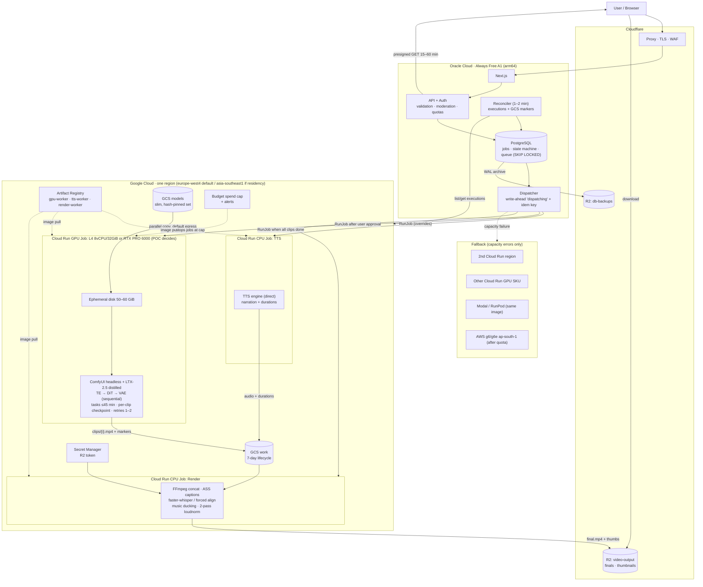

# 04 — Final Recommended Architecture (Chief Architect Arbitration)

| Field | Value |
|---|---|
| Author | Chief Architect (independent arbiter) |
| Date | 2026-11-11 |
| Inputs | `architecture.txt` (original), `01`/`02` (independent reviews), `03` (three-round debate) |
| Chief Architect re-verifications | Cloud Run GPU jobs region/SKU table (docs.cloud.google.com/run/docs/configuring/jobs/gpu). LTX system requirements and the ComfyUI A2V guide (docs.ltx.io). All other facts are taken from agent findings that **both** agents verified or accepted during the debate. |
| Labels | **[FACT]** confirmed with source. **[REC]** evidence-supported recommendation. **[POC]** must be proven by test. **[TRADE-OFF]** judgement call. |
| Scope rule | MVP first: the simplest architecture that can reliably run the workload. Nothing was deployed, created or benchmarked. **Every runtime number below is either from an official price sheet or is explicitly parametric.** |

---

## 0. Executive verdict

### Is the original architecture viable?

**Yes in shape, no as specified.**

The core pattern is sound and survives the debate intact:
- a free always-on control plane
- scale-to-zero GPU batch jobs
- models in object storage, outputs in R2
- CPU-side final assembly
- a provider-agnostic job interface

Seven concrete specifications in the document are wrong or would fail in production:
1. The model's hardware requirements exceed the proposed machine. LTX-2.5's official minimum is 32 GB+ VRAM and 32 GB RAM; the plan has L4 24 GB and 16 GiB RAM.
2. One monolithic 60–90 min execution with 0 retries is not survivable. GPU tasks are killed on maintenance, and spend caps kill in-flight tasks.
3. "Copy models to temporary local storage" is RAM on Cloud Run unless an ephemeral disk is attached.
4. Two Docker images cannot share one GPU execution.
5. The cost table uses Tier 1 prices for a Tier 2 region.
6. The fallback chain is not usable today: Mumbai Cloud Run L4 is invitation-only, and AWS G/VT quota defaults to 0.
7. The model licence has an unresolved "competing products" clause that could block the business entirely.

### Five most important changes

1. **Licence gate first.** Get written clarification from Lightricks on LTX-2.x Attachment A item 20 ("directly competes") before writing worker code. Also clear the TTS weights licence. Replace "VoiceStudio" (an AGPL app) with a directly called TTS engine.
2. **Right-size, and prove the GPU by POC.** Use 8 vCPU / 32 GiB on L4, plus an ephemeral disk for models. The baseline is spec-compliant hardware (Cloud Run RTX PRO 6000 96 GB). The L4 must *earn* production by $/output-second at acceptable quality.
3. **Chunked, checkpointed, retryable GPU tasks.** Each task is ≤45 min, with one clip checkpointed to GCS at a time, deterministic seeds, `maxRetries` 1–2, and failure classification. This replaces "one execution, 60–90 min, 0 retries".
4. **Narration-first pipeline with GPU work narrowed to LTX only.** TTS runs before the GPU job, so the user approves before GPU spend. Captions and alignment run on CPU. Rendering is FFmpeg-only on a CPU job. The GPU job writes only to same-region GCS. Only finals go to R2.
5. **Postgres state machine, reconciler and hard spend cap.** Use a write-ahead `dispatching` state with an idempotency key, a reconciler against Cloud Run executions, a GA budget spend cap on the Cloud Run project, and per-user GPU-second quotas in Postgres.

### What to build first

A **one-week de-risking spike**, before the web app:

| Step | What | Why |
|---|---|---|
| POC-0 | Licence answer requested; quota requests filed | These have external lead times |
| POC-1 | Deploy a do-nothing Cloud Run GPU job with a 50 Gi ephemeral disk | Confirms GPU and ephemeral disk work together; undocumented today |
| POC-2 | Model staging benchmark | Measures the cost of loading models |
| POC-3 | LTX-2.5 fit/speed/quality matrix on L4 8/32 vs RTX PRO 6000 | Decides which GPU to use |

Everything else (Next.js, auth, billing UI) is conventional and should wait until POC-3 proves the unit economics.

### What not to pay for initially

- Any always-on GPU (VM or min-instances)
- GKE
- Direct VPC + Cloud NAT or Serverless VPC connectors (unless POC-2 proves a gain)
- Managed queues (Pub/Sub, Cloud Tasks, SQS): Postgres is enough at this scale
- Managed Postgres while in free beta: Oracle + off-box backups suffices; re-evaluate before taking payments
- Remotion licence: FFmpeg-only MVP
- AWS/second-cloud fallback infrastructure: file the quota request, build nothing
- Reserved/committed-use discounts
- CDN beyond Cloudflare's included tier
- A100/H100-class GPUs

### Recommended final MVP architecture (one paragraph)

Oracle Always Free A1 runs Next.js, API, auth, Postgres and a Postgres-backed job queue, state machine and reconciler, with Cloudflare in front and WAL backups to R2. A CPU Cloud Run job does TTS. The user approves. One Cloud Run **GPU job** (single pinned ComfyUI + LTX-2.5 distilled image) runs in **europe-west4** by default, or asia-southeast1 if data residency requires APAC. It runs on **L4 8 vCPU / 32 GiB** if POC-3 passes, otherwise **RTX PRO 6000 20 vCPU / 80 GiB**. It stages a slim, hash-pinned model set from same-region GCS to an ephemeral disk, then generates clips in ≤45-min checkpointed tasks into a GCS work bucket. A CPU Cloud Run job assembles with FFmpeg (captions via forced alignment/faster-whisper, two-pass loudnorm) and uploads the final to **R2**. Users download via 15–60 min presigned URLs. A spend cap plus app quotas bound cost. Fallback: second Cloud Run region, then other GPU SKU, then Modal/RunPod, then AWS g6/g6e after quota.

### What must be benchmarked before production

See section 18. In short:
- ephemeral disk on GPU jobs
- staging throughput per path
- LTX-2.5 peak VRAM / peak host RSS / seconds per clip / quality on each GPU arm
- page-cache memory accounting
- TTS real-time factor on CPU
- checkpoint/resume under SIGTERM and spend-cap trip
- clip-to-clip consistency over a 2–3 min video
- FFmpeg render time and RAM for a 3-min 1080p output
- actual quota grants and turnaround
- end-to-end $/finished-minute

---

## 1. Final infrastructure provider selection

| Layer | Provider / service | Status vs original | Rationale |
|---|---|---|---|
| Control plane (web, API, auth, DB, queue) | **Oracle Cloud Always Free A1** (2 OCPU / 12 GB / 200 GB) | **Kept**, hardened | Free; load is light. No SLA, so add backups and a rebuild runbook. [FACT] Oracle docs; [REC] |
| Edge / DNS / TLS / WAF | **Cloudflare** (proxy in front of Oracle) | **Added** | Hides the origin IP and terminates TLS; already a vendor. [REC] |
| GPU batch compute | **Google Cloud Run Jobs (GPU)** | **Kept** | GA GPU jobs, scale-to-zero, ~5 s instance start, auto-granted 3-GPU quota, and **the only option here covered by GA budget spend caps**. [FACT] |
| CPU batch compute (TTS, render) | **Google Cloud Run Jobs (CPU)** | Clarified | Same tooling, same region as intermediates (free GCS transfer). [FACT] GCS pricing; [REC] |
| Model storage | **GCS Standard, regional bucket co-located with the jobs** | Kept, made regional | Same-location GCS→Cloud Run transfer is free. [FACT] |
| Intermediate storage | **GCS `work` bucket, 7-day lifecycle** | **Changed** (was R2) | Avoids ~$0.12/GiB GCP→internet egress and NAT for the GPU job. [FACT] pricing |
| Final output storage / delivery | **Cloudflare R2** | **Kept** | Zero egress; S3-compatible; presigned URLs. [FACT] |
| Container registry | **Artifact Registry**, same region | Kept | Same-region pulls; image streaming. [REC] |
| Secrets | **Google Secret Manager** (GCP side); env files with root-only permissions on Oracle | Clarified | Secrets stay out of images. [REC] |

**GPU provider decision: Google Cloud Run Jobs. Primary region europe-west4. asia-southeast1 if APAC data residency is required.**

**[TRADE-OFF]**
- Async generation has no user-latency requirement.
- Tier 1 regions are exactly 1/1.2 the Singapore price on every line item.
- europe-west4 offers **both** L4 and RTX PRO 6000 for jobs with **no** "may require quota increase" caveat. Chief Architect verified this against the Cloud Run jobs GPU page on 2026-11-11.
- us-central1 L4 carries a quota caveat.
- If your users are in India and you want lower upload latency for user media, the latency only affects the small input uploads, not generation.
- Choose Singapore only for a residency or contractual reason.

---

## 2. GPU model and VRAM requirements

| Fact | Value | Source |
|---|---|---|
| LTX-2.5 official minimum | "NVIDIA GPU with a minimum 32GB+ VRAM", "32GB system memory", "100GB free space" | [FACT] docs.ltx.io system-requirements (re-verified 2026-11-11) |
| LTX-2.5 recommended | A100 80GB or H100, 64GB+ RAM, 200GB+ SSD | [FACT] same |
| Model | 22B transformer + Gemma 4 12B text encoder; full download ~66 GiB | [FACT] Lightricks HF/README (both agents) |
| Community Q4_K_M GGUF DiT | 13.58 GB (not an official Lightricks artifact) | [FACT] HF file size |
| Official int8 DiT | ~21.5 GB; unlikely to be fully VRAM-resident on 24 GB | [FACT] size; [POC] fit |
| Gemma TE | int8 15.37 GB; bf16 26.26 GB; community Q4 ~8.4 GB | [FACT] HF file sizes |
| L4 | 24 GB VRAM | [FACT] Cloud Run GPU page |
| RTX PRO 6000 Blackwell | 96 GB VRAM; Cloud Run minimum 20 vCPU / 80 GiB | [FACT] Cloud Run GPU page |

**Decision**

- **POC baseline:** RTX PRO 6000 (spec-compliant; official NVFP4/bf16 distilled path with the text encoder resident). This establishes the quality reference. **[REC]**
- **Cost-down candidate:** L4 at 8 vCPU / 32 GiB using a distilled DiT (Q4_K_M / Q5_K_M GGUF or official int8 with offload), with the text encoder run **sequentially** before the DiT, never co-resident. **[POC]**
- **Production choice rule:** pick the arm with the lowest **$/output-second** that passes a blinded quality bar against the baseline.
  - Break-even at Tier 1 prices: RTX PRO 6000 ($3.1868/h) must be ≥ **2.24×** faster per output-second than L4 8/32 ($1.4209/h) to win.
  - The same ratio holds in Singapore ($3.8241 vs $1.7051).
  - Not chosen by assertion. **[FACT] arithmetic; [POC] the outcome**
- **Rejected for MVP:** A100/H100 (not offered on Cloud Run jobs; would force VMs/other vendors), A10G/AWS G5 (24 GB, older Ampere, no advantage over L4 for this workload). **[REC]**

---

## 3. CPU and RAM configuration

| Workload | Configuration | Basis |
|---|---|---|
| GPU job, L4 arm | **8 vCPU / 32 GiB**, 2nd-gen execution environment, ephemeral disk 50–60 GiB | LTX minimum 32 GB RAM; ComfyUI offload uses host RAM; the in-memory FS counts against memory [FACT]; 8/32 is the max L4 shape (Agent 2) [REC] |
| GPU job, RTX PRO 6000 arm | **20 vCPU / 80 GiB** (platform minimum) + ephemeral disk | [FACT] Cloud Run GPU page |
| TTS CPU job | 4–8 vCPU / 8–16 GiB (POC-6 decides) | [POC] |
| Render CPU job (FFmpeg) | 8 vCPU / 16–32 GiB + ephemeral disk | [POC] (POC-9) |
| Oracle A1 | 2 OCPU / 12 GB (existing) | [FACT] |

**Never** stage models in the default writable filesystem: it is memory-backed. **[FACT]** Cloud Run container contract.

---

## 4. Job orchestration

### 4.1 End-to-end flow

```
User submits → API validates + moderates + checks quota → Postgres job (queued)
→ dispatcher: TTS CPU job → narration audio + durations in GCS → job (awaiting_approval)
→ user approves script/voice → clip plan (num_frames % 8 == 1 per clip, from measured durations)
→ dispatcher: write state=dispatching + idempotency key → RunJob(GPU, overrides: job_id, clip ranges)
→ GPU tasks: stage models → generate clips k..n → write gs://work/{job}/clips/{i}.mp4 + done-marker
→ reconciler sees all markers → dispatcher: RunJob(render CPU)
→ render: FFmpeg concat + captions + music ducking + 2-pass loudnorm → upload final to R2
→ state=done → user gets presigned URL (15–60 min)
```

### 4.2 State machine (Postgres)

`queued → tts_running → awaiting_approval → dispatching(idem_key) → running(exec_id) → clips k/n → rendering(exec_id) → done | failed(reason_class) | cancelled`

- **Write-ahead dispatch.** Persist `dispatching` plus an idempotency key **before** calling `RunJob`. Label executions with `job_id`. **[REC]** (closes the orphan/duplicate GPU-spend window)
- **Reconciler** (cron on Oracle, every 1–2 min):
  - lists executions by label via the Cloud Run API
  - reads GCS done-markers
  - advances or fails jobs
  - cancels executions with no matching DB row
  - Callbacks from workers are **hints**, never the source of truth. **[REC]**
- **Concurrency.** Global GPU concurrency of 1 at launch (configurable ≤ quota of 3). Per-user concurrency of 1. **[REC]**

### 4.3 GPU job shape

| Setting | Value | Basis |
|---|---|---|
| Task timeout | **≤ 45 min** (each task covers ⌈clips/k⌉ clips) | Google: "one hour or lesser"; 12 h is Preview; maintenance terminates GPU tasks [FACT] |
| Retries | **maxRetries = 1–2**, resume skips completed clips | Checkpointing makes retries cheap and idempotent [REC] |
| Parallelism | 1 (default); ≤ GPU quota for priority tiers | [REC] |
| Zonal redundancy | `--no-gpu-zonal-redundancy` (cheaper; best-effort failover) | [FACT] Cloud Run GPU page |
| Drain-on-lease | A task may take extra already-queued jobs at start; **never idles waiting** | [REC] (converged in debate) |
| Watchdog | Per-clip wall-clock limit (≈ 3× POC p95), so a hung sampler fails fast | [REC] |

---

## 5. Model storage

- **Bucket:** `gs://<project>-models-<region>`, regional, Standard class, same region as the jobs. Object versioning on. Uniform bucket-level access. **[REC]**
- **Contents:** only the **slim working set**, pinned by SHA-256 in a manifest:
  - distilled DiT (chosen quantisation)
  - text encoder (chosen quantisation)
  - VAE (and audio VAE only if LTX audio is used)
  - upscaler only if the 2-stage path is used
  - TTS weights only if TTS moves into the GPU job

  The original "≈50 GB of everything" is not staged per run. **[REC]**
- **Prohibited at runtime:** ComfyUI/HF auto-downloads (blocked), prompt enhancer (off by default; it is a further model load). **[REC]** (both agents)
- **Supply chain:** community GGUFs are mirrored once into the bucket after hash verification and licence review. Workers never pull from Hugging Face. **[REC]**

## 6. Model caching strategy

Ranked candidate staging paths. **POC-2 picks the winner; the pass criterion is staging ≤ 15% of billed GPU time per execution.**

| Path | Notes | Status |
|---|---|---|
| (a) Parallel `gcloud storage cp` over **default egress** → ephemeral disk | No VPC, no NAT; throughput undocumented | **Baseline** [POC] |
| (b) Slim model set **baked into the image** (image streaming from same-region Artifact Registry) | Removes the copy step; very large images; rebuild on model change | Strong alternative [POC] |
| (c) Direct VPC all-traffic + Private Google Access → ephemeral disk | Google's documented "optimize" path, but capped at **1 Gbps per instance** (~125 MB/s → ≥ 254 s for 32 GB) with ≥1 min connection delay | Benchmark arm only [FACT] limits |
| (d) GCS FUSE with buffered read | Avoid random FUSE reads during inference | Benchmark arm [POC] |

**Cross-execution cache:** Cloud Run jobs have no persistent local cache between executions; every execution pays staging. **[FACT]** Amortisation comes from (i) drain-on-lease within an execution and (ii) the phase-2 warm-disk VM (section 17).

**Within an execution:** load the text encoder → encode all clip prompts for the task → free → load DiT → sample all clips → VAE decode per clip. This avoids reloading per clip. **[REC]** (sequential-stage rule from the original doc, applied per task rather than per clip)

## 7. Output storage

| Data | Store | Lifetime | Access |
|---|---|---|---|
| Narration audio, clip MP4s, alignment JSON, render inputs | GCS `work` bucket (same region) | 7-day lifecycle delete | Worker SAs only |
| Final MP4, thumbnails, previews | **R2** `video-output/users/{user}/{job}/` | Product retention policy (e.g. 30–90 days on free tier); R2 lifecycle rule | **Presigned GET, 15–60 min**, issued after an ownership check. Presigned URLs work on the S3 endpoint only, not custom domains [FACT] |
| DB backups (WAL-G / pgBackRest) | R2 separate bucket | 14–30 days | Backup token only |

Only the **render job** holds an R2 write token. The GPU job never talks to the internet, so it needs no NAT. **[REC]**

## 8. Container structure

| Image | Contents | Runs on | Notes |
|---|---|---|---|
| `gpu-worker` | CUDA runtime, PyTorch, **ComfyUI + ComfyUI-LTXVideo (pinned commits)**, headless `worker_entrypoint.py`, staging script, manifest verifier | Cloud Run GPU job | **One image** — "the GPU can only be attached to one container" [FACT]. Models **not** baked unless POC-2 path (b) wins. |
| `tts-worker` | Chosen TTS engine called directly (e.g. OmniVoice code is Apache-2.0; **weights licence to verify**) | Cloud Run CPU job (or first GPU stage if POC-6 fails) | Replaces "VoiceStudio" (AGPL-3.0 app, not a library) [FACT] |
| `render-worker` | FFmpeg (static build), faster-whisper (MIT) or a forced aligner, caption (ASS) generator, R2 client | Cloud Run CPU job | FFmpeg-only MVP; Remotion via `@remotion/renderer` later if templating is needed (licence: >3 employees ⇒ paid) [FACT] |
| `web` | Next.js, API, auth, dispatcher, reconciler | Oracle A1 (**arm64** builds) | systemd or Docker Compose |

All images are built in CI, scanned, tagged by digest, and deployed by digest. **[REC]**

## 9. Queue and database architecture

- **PostgreSQL 16+ on Oracle A1**: users, jobs, job_events (append-only), quotas, plans, consents (voice-clone), moderation results. **[REC]**
- **Queue = Postgres** (`SELECT … FOR UPDATE SKIP LOCKED`, or pg-boss). No external queue at MVP scale. GPU concurrency is 1–3, and the reconciler, not the queue, guarantees correctness. **[TRADE-OFF]**
  - Add Pub/Sub or Cloud Tasks only if there are multiple dispatchers or the throughput exceeds what Postgres polling handles.
- **Backups:** continuous WAL archiving to R2 with **monthly restore drills**. Oracle free tier gives only 5 volume backups [FACT]. **RPO ≤ 5 min, RTO ≤ 1 h** via an IaC/Ansible rebuild runbook. **[REC]**
- **Before taking payments:** re-evaluate managed Postgres. The trigger is when the restore drill fails RTO or paying-customer data makes a single free VM unacceptable. **[TRADE-OFF]**

## 10. Security and IAM

| Principal | Permissions | Mechanism |
|---|---|---|
| `oracle-dispatcher` SA | Custom role: `run.jobs.runWithOverrides`, `run.executions.get/list/cancel` on the **specific jobs only**; `storage.objects.get/list` on the `work` bucket (markers) | MVP: SA key on Oracle (root-only, 90-day rotation). **Before paid launch: Workload Identity Federation (OIDC with uploaded JWKS)** to eliminate long-lived keys [FACT] WIF docs |
| `gpu-worker` SA | `storage.objectViewer` on models; `storage.objectCreator`+`objectViewer` on `work/{job}` | Cloud Run service identity, no keys |
| `tts-worker` / `render-worker` SA | Read/write `work`; render reads R2 token from Secret Manager | Service identity |
| R2 token | Object read/write on `video-output` only; separate backup token | Cloudflare scoped API token |

Controls:
- **Moderation and validation before any GPU spend**: prompt text, uploaded images/audio (type, size, duration, malware scan).
- **Voice cloning requires recorded consent** (stored in DB).
- Do not strip LTX watermark/provenance (licence item 19). **[FACT]** licence; **[REC]**
- Per-job scratch directories wiped at task end. No shared per-user artefacts between jobs. **[REC]**
- Oracle host:
  - SSH key-only on a non-default port or via an allowlist
  - Postgres bound to localhost
  - only 80/443 exposed, from Cloudflare IP ranges
  - unattended security updates
- Logs must not contain prompts that include PII beyond what is needed. Set a retention policy.

## 11. Networking

- **User ↔ Oracle:** via Cloudflare proxy (TLS, WAF basics, origin IP hidden).
- **Oracle → Google APIs:** HTTPS with SA credentials (Cloud Run Admin API, GCS).
- **Cloud Run jobs → GCS / Artifact Registry:** **default egress, no VPC, no NAT** (baseline). GCS is reachable without additional networking [FACT]. Direct VPC is adopted only if POC-2 shows it is materially faster despite the 1 Gbps cap [FACT].
- **Render job → R2:** public internet egress (~$0.12/GiB; finals only). [FACT] GCP network pricing.
- **User ↔ R2:** presigned GET on the R2 S3 endpoint.
- **Region co-location:** model bucket, work bucket, Artifact Registry and all jobs in **one region**. Cross-region pulls cost money and time. [FACT] pricing.

## 12. Monitoring and logging

| Signal | Source | Alert |
|---|---|---|
| Per-job timeline: `stage_seconds`, `te_seconds`, `dit_seconds_per_clip`, `vae_seconds`, `peak_vram`, `peak_rss`, `exit_class` | Structured JSON logs from workers (Cloud Logging) → log-based metrics; copied to `job_events` | p95 drift > 30% vs POC baseline |
| Execution failures by class (capacity / OOM / timeout / deterministic) | Cloud Run execution status + exit codes | Any OOM; capacity failures > N/day |
| Stuck jobs | Reconciler | Job in `running` > task timeout + 10 min |
| Spend | Cloud Billing budget alerts (50/80/100%) + **spend cap** + app GPU-second counter | Daily GPU-seconds > plan |
| Oracle health | External uptime check (e.g. Cloudflare health check / free external monitor) + node exporter | Down > 2 min |
| Backups | WAL-G status, restore-drill results | Archive lag > 15 min |

Keep Cloud Logging at WARNING for library noise. Add exclusion filters for verbose ComfyUI output. Log volume is a hidden cost. **[REC]**

## 13. Failure handling

| Failure | Detection | Handling |
|---|---|---|
| GPU capacity / quota unavailable | `RunJob` error or task fails to start with capacity class | Retry with backoff ×3 in the same region → **fallback region** (section 17). Never treat as a generation failure. |
| Maintenance SIGTERM (10 s) mid-clip | Exit code / signal | Flush in-progress state; Cloud Run retry resumes from last completed clip |
| Spend cap tripped | Tasks fail; billing notification | Pause dispatcher globally; jobs → `paused_budget`; manual resume |
| CUDA OOM | Exit class | **Do not retry with the same parameters.** Mark failed or downgrade the resolution tier if the plan allows. Alert. |
| Hung sampler | Per-clip watchdog | Kill task → retry once → fail |
| Bad model artefact | Manifest hash mismatch at staging | Fail fast before GPU work starts (exit early to minimise billed time) |
| Oracle VM down | Uptime check | Jobs in flight keep running in GCP. On recovery the reconciler re-syncs state from executions plus GCS markers. Rebuild runbook if lost. |
| Duplicate dispatch | Idempotency key + execution label | Reconciler cancels the newer duplicate |
| User-visible failure | State `failed(reason_class)` | Notify the user. Do not charge credits for platform-class failures. |

## 14. Retry strategy

| Layer | Policy |
|---|---|
| `RunJob` API call (dispatcher) | 3 attempts, exponential backoff (5 s → 60 s), same idempotency key |
| Capacity errors | 3 attempts over ~10 min in the primary region → fallback chain |
| Cloud Run task | `maxRetries` = **1** at launch (2 after POC-4 proves resume is idempotent) |
| Per clip | Deterministic seed; skip if `clips/{i}.mp4` + marker exist. A clip failing twice fails the job (no infinite loops). |
| Render job | `maxRetries` = 2 (CPU is cheap; output is idempotent overwrite) |
| OOM / validation / moderation errors | **0 retries**: deterministic |

## 15. Cost-control measures

### 15.1 Verified unit rates (Cloud Run jobs, instance-based; official pricing page as verified by both agents)

| Configuration | europe-west4 / us-central1 (Tier 1) | asia-southeast1 (Tier 2, ×1.2) |
|---|---|---|
| L4, 4 vCPU / 16 GiB (original) | $1.0465/h | **$1.2558/h** (doc said $1.0465, wrong tier) |
| **L4, 8 vCPU / 32 GiB (recommended)** | **$1.4209/h** | $1.7051/h |
| RTX PRO 6000, 20 vCPU / 80 GiB | $3.1868/h | $3.8241/h |

Derivation (Tier 1, L4 8/32): 0.0001867 × 3600 (GPU) + 8 × 0.000018 × 3600 (CPU) + 32 × 0.000002 × 3600 (RAM) = 0.6721 + 0.5184 + 0.2304 = **$1.4209/h**. **[FACT]** rates; arithmetic.

### 15.2 Cost model (parametric — no benchmark exists yet)

```
GPU $ per video = rate/3600 × ( T_start + T_stage + N_clips × t_clip + T_te + T_vae + T_upload )
N_clips ≈ video_seconds / clip_seconds        (e.g. 150 s / 5–10 s ⇒ 15–30 clips — illustrative)
Render $ ≈ CPU rate × T_render ;  Egress $ ≈ 0.12 × final_GiB
```

The only staging figure grounded in a document: on the Direct VPC path, 32 GB takes ≥ 254 s ⇒ ≈ $0.10 (Tier 1) / $0.12 (Singapore) per execution at L4 8/32. **t_clip is unknown until POC-3. No per-video price is stated until then.** The original "7.5 min per video" is unsupported.

### 15.3 Controls

1. **GA budget spend cap** on the dedicated Cloud Run project, at 80–90% of the monthly ceiling. Note: it is estimated and monthly, and a trip kills in-flight work. [FACT]
2. **Budget alerts** at the original $5 / $10 / $20, plus 50/80/100% of the cap.
3. **App-level quotas** in Postgres: GPU-seconds per user per day, max output seconds per plan, max concurrent jobs per user, and a global daily GPU-second ceiling enforced by the dispatcher.
4. **User approval gate** after TTS and before GPU spend.
5. **Moderation before dispatch.** Rejected prompts cost zero GPU.
6. **Early-exit validation:** manifest hashes, input sanity checks, and VRAM pre-flight before sampling.
7. **Lifecycle rules:** GCS work 7 days; R2 per retention policy; Artifact Registry cleanup policy (keep the last N digests).
8. **Isolated GCP project** for GPU jobs, so the spend cap scope is clean.
9. **No idle resources:** no min-instances, no VPC connector, no NAT, no always-on VM.

## 16. Deployment architecture



**Environments:** `dev` (same project layout, low caps) and `prod`. A separate GCP project per environment keeps spend caps and IAM clean. Infrastructure is defined in Terraform. Images are deployed by digest from CI. Job definitions are versioned. **[REC]**

## 17. Fallback provider strategy

| Order | Target | Readiness work now | Trigger |
|---|---|---|---|
| 1 | **Cloud Run, second region** (asia-southeast1 ↔ europe-west4) | Duplicate the model bucket (or a dual-region copy) and job definitions; request quota in both in week 1 | Capacity/quota error after 3 retries |
| 2 | **Cloud Run, other GPU SKU** (RTX PRO 6000 ↔ L4) | Same image, one flag; per-SKU model manifest | L4 capacity exhausted or job needs >24 GB |
| 3 | **Serverless GPU vendor (Modal / RunPod)** with the same container | Adapter implementing the common job contract; **no spend-cap equivalent, so use vendor-side limits** | GCP-wide shortage |
| 4 | **AWS g6 (L4) / g6e (L40S 48 GB), ap-south-1** | **File the G/VT quota request now (default 0)**. Build nothing until needed. | Strategic or long-outage |

- **AWS G5 (A10G) is dropped.** G6/L4 matches the primary GPU class. g6e meets LTX's 32 GB+ spec.
- **Phase-2, not a fallback:** move long-form generation to a **warm-disk GPU VM pool** (GCE G2/G4 or AWS g6/g6e with NVMe holding models) when measured staging > 15% of billed GPU time **or** busy time > ~100 GPU-h/month (illustrative break-even). The VM side gains 1 h maintenance notice, but loses spend-cap coverage. Verify G2 regional pricing via the Billing Catalog API before deciding. **[TRADE-OFF] / [POC]**

## 18. Items that must be benchmarked before production (POC register)

| ID | Question | Pass criterion |
|---|---|---|
| POC-0 | Licence: LTX-2.x Attachment A item 20 applicability; TTS weights licence; Gemma terms | Written answer. **Blocks paid launch.** |
| POC-1 | Ephemeral disk attaches to a GPU job (per-instance quota > 10 GiB) | Deploys; `df` shows ≥ 50 GiB |
| POC-2 | Fastest staging path (a/b/c/d in section 6); page-cache accounting vs memory limit | Staging ≤ 15% of billed time; no OOM at 32 GiB |
| POC-3 | LTX-2.5 matrix: L4 8/32 {Q4_K_M, Q5_K_M, int8+offload} vs RTX PRO 6000 {NVFP4/bf16}; 720p/1080p; 121/241 frames | Peak VRAM, peak RSS, s/clip, blinded quality ⇒ **$/output-second** |
| POC-4 | Checkpoint/resume under SIGTERM and spend-cap trip | Retry skips done clips; no duplicates |
| POC-5 | 15–30-clip continuity (multishot vs I2V last-frame chaining vs LoRA) | Human rating rubric passes |
| POC-6 | TTS real-time factor on CPU | 3 min narration ≤ 5 min on 8 vCPU, equal quality |
| POC-7 | Image cold-start (8–15 GB image) | Execution start → first log line, measured |
| POC-8 | Quota grants and turnaround (both regions, both SKUs, ephemeral disk, AWS G/VT) | Granted; turnaround recorded |
| POC-9 | FFmpeg render of a 3-min 1080p output | vCPU-seconds and peak RAM within the CPU job shape |
| POC-10 | End-to-end cost per finished minute | Measured; sets pricing plans |

## 19. Original vs final: decision summary

| Decision | Original | Final | Class |
|---|---|---|---|
| Web/API/DB/queue | Oracle VPS | Oracle VPS + Cloudflare + WAL backups + reconciler | [REC] |
| GPU platform | Cloud Run Jobs | **Cloud Run Jobs** (kept) | [FACT]/[REC] |
| GPU | L4 24 GB | **POC: RTX PRO 6000 baseline vs L4 cost-down** | [FACT]/[POC] |
| CPU/RAM | 4 / 16 GiB | **8 / 32 GiB** + ephemeral disk | [FACT] |
| Region | Singapore | **europe-west4** (Singapore if residency) | [TRADE-OFF] |
| Model load | ~50 GB from GCS (FUSE or copy) | Slim pinned set → ephemeral disk via default egress (POC picks path) | [POC] |
| Images | 2 images, 1 execution | **1 GPU image** + separate TTS & render CPU images | [FACT] |
| Order | Video → voice | **Narration → approval → video → render** | [REC] |
| Whisper | GPU | **CPU** (faster-whisper / forced alignment) | [REC] |
| TTS | VoiceStudio on GPU | Engine called directly, CPU job (POC-6) | [FACT] licence / [POC] |
| Rendering | Remotion + FFmpeg | **FFmpeg-only MVP** | [TRADE-OFF] |
| Intermediates | R2 | **GCS work bucket** | [FACT] pricing |
| Finals | R2 | **R2** (kept) | [FACT] |
| Timeout/retries | 60–90 min / 0 | **≤45 min tasks / 1–2 retries + checkpoints** | [FACT] |
| Cost control | Alerts | **Spend cap + app quotas + approval gate** | [FACT] |
| Fallback | Mumbai CR → AWS G5 | 2nd CR region → other SKU → Modal/RunPod → AWS g6/g6e | [FACT]/[REC] |
| Licensing | Final production gate | **Gate 0** | [FACT] |
